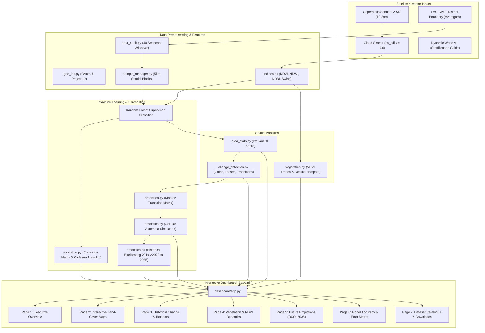
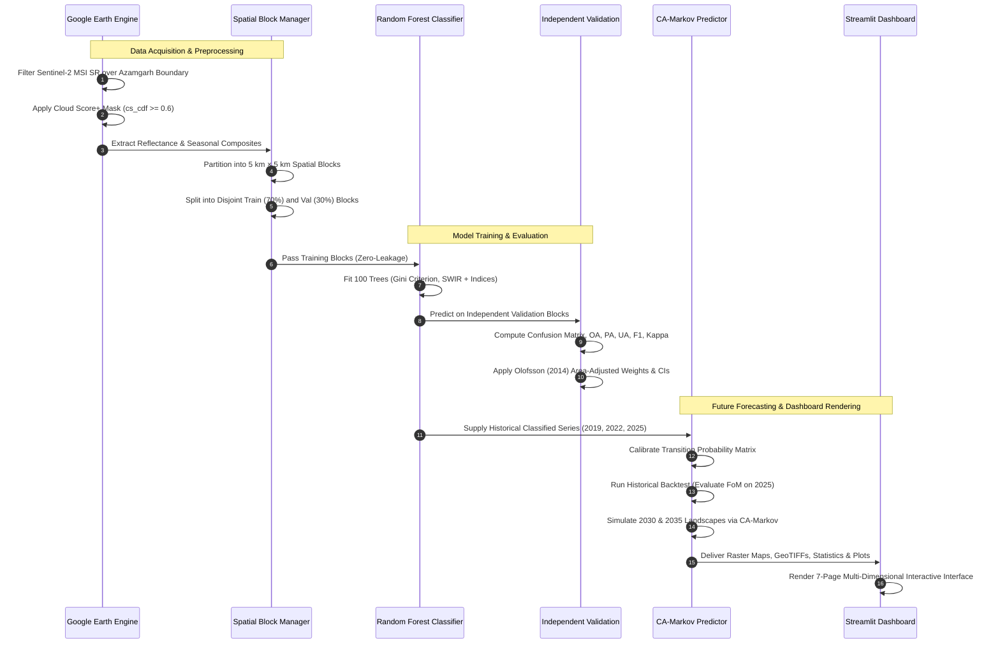

# System Architecture & Pipeline Workflow

This document illustrates the software engineering architecture and the scientific data flow for the **Azamgarh District LULC Monitoring and Future Prediction System**.

---

## 1. System Architecture Diagram

---

## 2. Scientific Data Flow & Validation Pipeline

